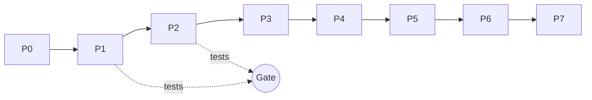

## How to use this plan

* Work one phase per chat session. Start each session with the prompt in [Session prompt](#session-prompt). Do not start the next phase until the current gate is closed.
* Update the [Progress tracker](#progress-tracker) and the [Requirement coverage](#requirement-coverage) table at the end of every phase. They are the only state the next session needs.
* Source of truth for requirements is [../requirements/refined/customer-order-prd.md](../requirements/refined/customer-order-prd.md). Do not re-read it in full each session; use the requirement slice listed in each phase.

## Token optimization rules

1. **One phase, one session.** A fresh session avoids paying for stale history. Carry state through the tracker and the phase review note only.
2. **Context pack per phase.** Load only the files listed under "Context pack". The matching `.github/instructions/*.instructions.md` file loads automatically by `applyTo`; do not paste it again.
3. **Requirement slice, not the whole PRD.** Read only the FR/NFR sections named in the phase (use a line-range read or search for `#### FR-nn`).
4. **Small modules.** Keep each source file under about 150 lines so later edits read little and diffs stay small.
5. **Mechanical checks run in scripts, not in the model.** Tests, the security scan (P0 adds `npm run check`) and layering checks run in a terminal. Ask the terminal subagent for failures only, not full output.
6. **Review the diff, not the repository.** Reviews read `git diff` of the phase plus the checklist below. Do not re-read untouched files.
7. **Right-size the model.** Use a stronger model for domain rules, storage integrity and the security review. Use a cheaper model for boilerplate (CSS, form wiring, test scaffolds, docs). Record the model per phase in the review note (DR-03).
8. **Test first for domain and storage.** A failing test is a cheaper and clearer spec than prose. Generate tests and code in one pass per module, then run once.
9. **No speculative work.** Out-of-scope items (see PRD Non-Goals) are not built, researched or discussed.
10. **Cap fix loops.** After two failed fix attempts on the same failure, stop, write the failure into the review note and change approach or escalate to the user.

## Phase gate (applies to every phase)

A phase closes only when every item passes. Record results in `docs/reviews/phase-N-review.md` (max about 40 lines, template below).

| Gate item        | How it is checked                                                                                                                      |
|------------------|----------------------------------------------------------------------------------------------------------------------------------------|
| Tests            | `npm test` passes. Domain and storage changes include tests. E2E specs for the phase pass from P3 on (`npm run test:e2e`).             |
| Automated scan   | `npm run check` passes (forbidden APIs, layering, inline script or style, CDN URLs).                                                    |
| Code quality     | Checklist A below, applied to the phase diff.                                                                                          |
| Security         | Checklist B below, applied to the phase diff.                                                                                          |
| Requirement fit  | Each FR/NFR in the phase has its acceptance bullets checked and the evidence (test name or manual step) written into the coverage table. |
| Decisions        | New assumptions or choices get a record in `docs/decisions/` (use the write-decision-log prompt) and a row in `decision-tracker.md`.    |
| Review note      | `docs/reviews/phase-N-review.md` written, including findings fixed and findings deferred.                                              |
| Commit           | One commit per phase after the gate, message per the commit-message instructions.                                                       |

### Checklist A: code quality

* Layering holds: domain has no DOM or storage, storage has no UI, UI computes nothing (no inline totals, validation, search or filter).
* Functions are pure where the domain guideline requires it; inputs are not mutated; ids and clocks are injected.
* No duplicated logic, dead code, unused exports or commented-out code. Names describe behaviour.
* Errors follow the `{ ok, value }` or `{ ok: false, errors }` shape; user input never throws.
* Money is integer cents everywhere except one display helper.
* Files stay small and single-purpose. No new dependency was added.

### Checklist B: security

* No `innerHTML`, `outerHTML`, `insertAdjacentHTML`, `eval`, `new Function`, `document.write`, inline handlers, inline `<script>` or `<style>`.
* User and stored text only reaches the DOM through `textContent` or a fixed allow-list of attributes. No user data in `href`, `src` or `style`.
* Hash route parameters and stored data are treated as untrusted: unknown or malformed ids give a not-found state.
* CSP meta tag is present and unchanged; no CDN or external URL.
* Nothing is logged to the console that contains customer data.
* Storage reads survive tampered JSON (wrong types, huge strings, missing fields) without a crash.
* Manual XSS probe for any phase that adds rendering: `` in every free-text field renders as plain text.

### Review note template

```markdown
# Phase N review
Model(s) used: <name per task> | Date: <yyyy-mm-dd>
Scope: <FR/NFR ids>
Gate: tests <pass/fail, count> | check <pass/fail> | quality <pass/fail> | security <pass/fail> | requirements <pass/fail>
Findings fixed: <bullet list, one line each>
Findings deferred: <bullet list with reason or none>
AI output corrected by me: <what was wrong and how it was fixed>
Decisions added: <D-ids or none>
```

The "AI output corrected by me" line supports BRD O-04 (engineering ownership).

## Session prompt

Use this to start every phase session. Replace `N`.

```text
Execute Phase N of docs/plan/implementation-plan.md. Read only that phase, its
context pack and its requirement slice. Implement the tasks, run the exit gate
(tests, npm run check, Checklist A and B on the diff), write
docs/reviews/phase-N-review.md, update the tracker and coverage table, then stop.
Do not start Phase N+1.
```

## Progress tracker

| Phase | Name                                   | Status      | Gate closed | Model(s) used | Review note |
|-------|----------------------------------------|-------------|-------------|---------------|-------------|
| P0    | Foundations and guardrails             | Closed      | 2026-10-11  | Claude Haiku 5.5 | [phase-0-review.md](../reviews/phase-0-review.md) |
| P1    | Domain logic                           | Closed      | 2026-10-11  | Claude Haiku 5.5 | [phase-1-review.md](../reviews/phase-1-review.md) |
| P2    | Storage layer                          | Closed      | 2026-10-11  | Claude Haiku 5.5 | [phase-2-review.md](../reviews/phase-2-review.md) |
| P3    | App shell and customers UI             | Closed      | 2026-10-12  | Claude Haiku 5.5 | [phase-3-review.md](../reviews/phase-3-review.md) |
| P4    | Orders UI                              | Closed      | 2026-10-12  | Claude Haiku 5.5 | [phase-4-review.md](../reviews/phase-4-review.md) |
| P5    | Responsive and accessibility hardening | Closed | 2026-10-12 | Claude Haiku 5.5 | [phase-5-review.md](../reviews/phase-5-review.md) |
| P6    | End-to-end, performance and capacity   | Closed      | 2026-10-12  | Claude Haiku 5.5 | [phase-6-review.md](../reviews/phase-6-review.md) |
| P7    | Final validation and handover          | Closed      | 2026-10-12  | Claude Haiku 5.5 | [phase-7-review.md](../reviews/phase-7-review.md) |

Status values: Not started, In progress, Gate failed, Closed.



P1 and P2 are sequential because repositories call domain validators. P3 and P4 depend on both.

## Phases

### P0 Foundations and guardrails

Goal: create the skeleton and the cheap automated checks so later reviews cost less.

Context pack: `AGENTS.md`, `package.json`, `playwright.config.js`.
Requirement slice: FR-18, NFR-03 (CSP), DR-02.

Tasks:

* [x] `src/index.html`: viewport meta, CSP meta from `ui.instructions.md`, `<main>`, module script `js/main.js`, link `css/*.css`.
* [x] `src/js/utils/dom.js`: `el(tag, props, ...children)` with an attribute allow-list and `textContent` only.
* [x] `src/js/utils/money.js`: `formatCents(cents, currency)`. `src/js/utils/config.js`: `CURRENCY = "USD"`, limits from `validation-limits` decision as named constants.
* [x] `tests/helpers/builders.js` (`makeCustomer`, `makeOrder`, `makeLine`) and `tests/helpers/fake-storage.js`.
* [x] `scripts/check.js` (no dependencies) and `npm run check`: fail on forbidden APIs in `src/` (`innerHTML`, `outerHTML`, `insertAdjacentHTML`, `eval`, `new Function`, `document.write`, `on\w+=` attributes, `http(s)://` in HTML or JS, `console.` with data), and on layering breaks (domain or storage importing `ui/`, domain importing `storage/`, `localStorage` outside the composition root).
* [x] Add a `docs/reviews/review-template.md` containing the template above.
* [x] Confirm `npm start`, `npm test`, `npm run check` run clean on the skeleton.

Exit evidence: FR-18 start and test commands work; no runtime dependency in `package.json`.

### P1 Domain logic

Goal: all business rules as pure, tested functions.

Context pack: `.github/instructions/domain.instructions.md` (auto), `utils/config.js`, `tests/helpers/builders.js`.
Requirement slice: FR-01, FR-03, FR-05 to FR-10, FR-12, FR-04 (`canDeleteCustomer`), NFR-02, Data Model, Order Status Model.

Tasks (each module ships with its test file in `tests/domain/`):

* [x] `customer.js`: `validateCustomer` (name 1 to 100, optional email format, optional phone pattern and length), `isEmailTaken` (case-insensitive, ignores own id), `createCustomer`, `updateCustomer`, and `customerDeletionImpact` (the code name for `canDeleteCustomer`).
* [x] `order-line.js`: `validateLine` (description 1 to 500, quantity integer 1 to 9999, unit price in cents 0 to 10,000,000), plus a `parsePriceToCents(text)` that rejects more than two decimals and float math.
* [x] `order.js`: `createOrder` (requires customer and one line, status Draft), `orderTotalCents`, `addLine`, `updateLine`, `removeLine` (blocks removal of last line, blocks when not Draft), `confirmOrder`, `cancelOrder`, `canDeleteOrder`.
* [x] `search.js`: `searchCustomers` (name or email), `filterOrders` (status and customer-name query combined). Empty query returns all; trimmed; case-insensitive.
* [x] Tests cover: empty total, many lines, max values, invalid quantity or price, whitespace-only names, mixed-case and padded queries, illegal transitions, frozen inputs not mutated. Padded-query trimming: `tests/domain/search.test.js` (added 2026-10-12; `npm test` 128 pass, 0 fail).

Exit evidence: NFR-02 zero mismatches; FR-01, 03, 05, 06, 07, 08, 09, 10, 12 rules each map to a named test.

### P2 Storage layer

Goal: durable, versioned, safe persistence behind injected storage.

Context pack: `.github/instructions/storage.instructions.md` (auto), domain exports, `tests/helpers/fake-storage.js`.
Requirement slice: FR-04, FR-13, FR-14, FR-15, NFR-06, NFR-08.

Tasks:

* [x] `storage/store.js`: load and save the `{ schemaVersion, customers, orders }` document under `customer-order:v1`; safe parse; copies out; read-modify-write.
* [x] Corrupt, wrong-type or unknown-version data: back up raw value under `customer-order:corrupt-<timestamp>`, return the empty state and a `recovered` flag.
* [x] `storage/customer-repository.js` and `storage/order-repository.js`: list, get, save, delete; call domain validators; return `{ ok, errors }`; `setItem` failure returns `errors.storage`.
* [x] Referential integrity: refuse orders with unknown `customerId`; customer delete removes their orders in a single write; failed write removes nothing.
* [x] Migration hook for `schemaVersion` bumps with one example test.
* [x] Tests in `tests/storage/` per the storage guideline, including "stored data has `lines` and no total".
* [x] `storage/index.js` composition root is the only place that passes `globalThis.localStorage`.

Exit evidence: FR-13, 14, 15 covered by tests; D-17, D-18 behaviours confirmed.

### P3 App shell and customers UI

Goal: working customer journey end to end in the browser.

Context pack: `.github/instructions/ui.instructions.md` (auto), `utils/dom.js`, repository and domain exports (names only).
Requirement slice: FR-01 to FR-05, FR-11 (list placeholder), FR-14 banner, FR-15 banner, FR-16, FR-18.

Tasks:

* [x] `main.js`: hash router (`#/customers`, `#/customers/:id`, `#/orders`, `#/orders/:id`), unknown route falls back to the customer list; builds repositories at the composition root. Deferred: order routes fall back to the list until P4.
* [x] Components in `ui/components/`: `field`, `empty-state`, `banner` (`role="status"` and `role="alert"`), `confirm-dialog` (native `<dialog>` focus trap and restore), `table`.
* [x] `ui/views/customers.js`: list, empty state, "no results" state, search box, add form with inline errors and `aria-describedby`.
* [x] `ui/views/customer-detail.js`: fields, edit, delete with order count in the confirmation, not-found state. Deferred: orders section is placeholder text until P4 (FR-11); order-count path exercised in P4.
* [x] Recovered-data banner and save-failure banner wired to the `recovered` flag and `errors.storage`.
* [x] Minimal mobile-first CSS in `src/css/` using custom properties (full hardening is P5).
* [x] First Playwright spec `tests/e2e/customers.spec.js`: create, edit, search, delete with confirm, reload persistence, XSS probe, save failure (11 tests, 2 projects).

Exit evidence: FR-01 to FR-05, FR-13 to FR-16 acceptance bullets checked in the browser and by the e2e spec.

### P4 Orders UI

Goal: orders, lines, totals, status and list filters.

Context pack: `ui.instructions.md` (auto), order domain and repository exports, components from P3.
Requirement slice: FR-06 to FR-12, FR-16.

Tasks:

* [x] `ui/views/order-form.js`: pick customer, require first line, inline errors; saves as Draft.
* [x] `ui/views/order-detail.js`: lines table (Draft only editable), add, edit, remove with confirmation, last line cannot be removed, derived total refreshed after every change via `orderTotalCents`.
* [x] Status actions: Confirm, Cancel (after confirmation), Delete Draft (after confirmation); Confirmed and Cancelled are read-only.
* [x] `ui/views/orders.js`: list with customer name, status, total, created date; status filter plus customer-name search combined; empty and "no results" states.
* [x] Customer detail lists the customer's orders with status, total and link (FR-11).
* [x] E2E spec `tests/e2e/orders.spec.js`: create order, add or edit lines, total update, confirm, cancel, delete draft, filter plus search, read-only after confirm.

Exit evidence: FR-06 to FR-12 acceptance bullets checked; no total computed outside the domain (confirmed by `npm run check` and the diff review).

### P5 Responsive and accessibility hardening

Goal: meet FR-17, NFR-04 and NFR-05 before final validation.

Context pack: `src/css/*`, view files (names only), accessibility and browser-support decisions.
Requirement slice: FR-17, NFR-04, NFR-05.

Tasks:

* [x] CSS pass: breakpoints at 600px and 960px, tables wrapped or stacked, 44px touch targets, 16px inputs, visible focus, `prefers-reduced-motion`, `prefers-color-scheme`, contrast at least 4.5:1.
* [x] Keyboard pass: tab order, dialog focus trap and restore, Esc closes dialogs, form labels, `aria-invalid` and `aria-describedby`, banner roles.
* [x] Playwright checks in the `phone-360` project: no horizontal scroll on every route; add an axe-free manual contrast and keyboard checklist in the review note (no new dependency).
* [x] Manual widths 360, 768, 1280 (visual review in P7; order table scrolls inside its wrapper at 360px, and the headers remain on one line; see `docs/reviews/phase-7-review.md`).

Exit evidence: FR-17 checks pass at 360px and desktop; NFR-04 checklist signed in the review note.

### P6 End-to-end, performance and capacity

Goal: prove NFR-01 and NFR-07 and close regression gaps.

Context pack: e2e specs, search domain module, `utils/config.js`.
Requirement slice: NFR-01, NFR-07, NFR-08, O-03.

Tasks:

* [x] Seed helper (test-only, in `tests/helpers/`) that writes 500 customers and 5,000 orders into storage (`tests/helpers/volume.js`).
* [x] Node test that times `searchCustomers` and `filterOrders` at that volume against the 300 ms target, with a generous bound to avoid flakiness (`tests/domain/search-volume.test.js`).
* [x] E2E check that typing in the search box updates results within 300 ms at that volume (`tests/e2e/volume.spec.js`, both projects).
* [x] Measure serialized size at that volume and record it against the 5 MB limit in the review note and in the volume decision record (`docs/reviews/phase-6-review.md`, D-28).
* [x] Cross-browser run recorded as evidence for NFR-05. Latest P7 canonical `npm run test:e2e`: `desktop-chromium`, `desktop-webkit`, and `phone-360` 111 passed; `desktop-firefox --workers=1` 37 passed; exit 0. Standalone Firefox with default workers passed 37 tests and 74 tests with `--repeat-each=2`. Earlier full parallel Firefox failures were not reproduced; retain the D-36 serial stage as conservative test isolation.

Exit evidence: NFR-01 and NFR-07 numbers recorded (met, see `docs/reviews/phase-6-review.md` and D-28). Checklist A and B passed on the P6 diff and were re-run after the WebKit focus fix (see the review note). Closed 2026-10-12 after D-36. O-03 closed: search and filter tests and the volume e2e run at 500 customers and 5,000 orders (`search-volume.test.js`, `volume.spec.js`).

### P7 Final validation and handover

Goal: validate the whole solution against the requirements and close the delivery requirements.

Context pack: this plan's coverage table, PRD Traceability section, `docs/reviews/*`, `README.md`.

Tasks:

* [x] Fill every row of the coverage table with evidence; any FR or NFR without evidence is fixed or recorded as a deferred gap.
* [x] Full-repo run: `npm test`, `npm run check`, `npm run test:e2e`.
* [x] One whole-codebase security pass (Checklist B plus a read of `main.js`, `dom.js`, storage `store.js` only, where trust boundaries sit).
* [x] Reconcile `decision-tracker.md` with `docs/decisions/` (DR-01) and confirm each inferred-rationale record is either confirmed or flagged.
* [x] Confirm DR-03: every phase review note names the model(s) used.
* [x] Update `README.md` with run steps, test commands, known limits (no export, single browser).
* [x] Walk the six user journeys in the PRD in the browser: create a customer, create a Draft order, add a line and verify the total, confirm and cancel, then reload and verify persistence (see `docs/reviews/phase-7-review.md`).

Exit evidence: all coverage rows Done; all phase gates Closed; BRD O-01 to O-04 targets met.

## Requirement coverage

Fill the Evidence column with a test name, spec name or manual step. Status values: Pending, Done, Deferred.

| Requirement | Phase | Evidence | Status  |
|-------------|-------|----------|---------|
| FR-01       | P1, P3 | P1: `customer.test.js` validateCustomer name and email tests (domain). P3 e2e: "creates a customer, lists it and keeps it after reload", "shows inline errors and keeps the entered values", "rejects a duplicate email ignoring case". | Done |
| FR-02       | P3, P4 | P3 e2e: "creates a customer, lists it and keeps it after reload" (list); "edits a customer and keeps the changes after reload" (detail); "shows not-found for an unknown customer id and falls back for unknown routes". P4 e2e: "lists a customer's orders on the customer detail page", "shows the not-found state for an unknown order id". | Done |
| FR-03       | P1, P3 | P1: `customer.test.js` phone and email rules (domain). P3 e2e: "edits a customer and keeps the changes after reload", "rejects a duplicate email ignoring case". | Done |
| FR-04       | P1, P2, P3 | P1: `customer.test.js` customerDeletionImpact. P2: `customer-repository.test.js` "deletes a customer and their orders in one write", "failed delete removes nothing". P3 e2e: "deletes a customer only after confirmation and keeps the deletion after reload" (zero-order path). P4 e2e: "deleting a customer with orders states the order count and removes those orders", "keeps the customer and their orders when the customer delete cannot be saved". | Done |
| FR-05       | P1, P3 | P1: `search.test.js` searchCustomers (name or email, trimmed, case-insensitive). P3 e2e: "searches by name or email and shows a no-results message". Duplicate-email rule is FR-03. | Done |
| FR-06       | P1, P4 | P1: `order.test.js` createOrder requires customer and one line. P4 e2e: "creates a Draft order, shows the derived total and lists it", "shows inline errors on the new order form and keeps entered values". | Done |
| FR-07       | P1, P4 | P1: `order-line.test.js` validateLine description and quantity tests. P4 e2e: "adds, edits and removes lines and keeps the total in step", "keeps entered line values when the line cannot be saved". | Done |
| FR-08       | P1, P4 | P1: `order.test.js` orderTotalCents tests (derived, integer cents). P4 e2e: "creates a Draft order, shows the derived total and lists it", "adds, edits and removes lines and keeps the total in step". | Done |
| FR-09       | P1, P4 | P1: `order.test.js` Draft-only addLine, updateLine, removeLine tests. P4 e2e: "adds, edits and removes lines and keeps the total in step", "confirms an order and keeps its lines read-only". | Done |
| FR-10       | P1, P4 | P1: `order.test.js` confirmOrder, cancelOrder, Cancelled final state tests. P4 e2e: "confirms an order and keeps its lines read-only", "cancels a confirmed order only after confirmation". | Done |
| FR-11       | P4    | P4 e2e: "lists a customer's orders on the customer detail page". | Done |
| FR-12       | P1, P4 | P1: `order.test.js` canDeleteOrder allows only Draft. P4 e2e: "deletes a Draft only after confirmation", "keeps a Draft when the delete cannot be saved". | Done |
| FR-13       | P2, P3 | P2: `store.test.js` round trip with copies; `order-repository.test.js` "survive a fresh createAppStorage". P3 e2e: "creates a customer, lists it and keeps it after reload", "edits a customer and keeps the changes after reload". | Done |
| FR-14       | P2, P3 | P2: `store.test.js` corrupt JSON, unknown schemaVersion 99, wrong shape, orphan order, backup key and reset, `dismissRecovery`. P3 e2e: "reports recovered data once and stays dismissed after reload". | Done |
| FR-15       | P2, P3 | P2: `store.test.js` quota error keeps data and returns `STORAGE_ERROR_MESSAGE`; `customer-repository.test.js` and `order-repository.test.js` quota tests. P3 e2e: "shows a persistent save error and keeps the entered values" (add path). P4 e2e: "keeps a Draft when the delete cannot be saved", "keeps the customer and their orders when the customer delete cannot be saved". | Done |
| FR-16       | P3, P4 | P3 e2e: "shows an empty state with an add action on first load", "searches by name or email and shows a no-results message". P4 e2e: "shows empty states for orders and for the new order form without customers", "filters by status and searches by customer name together". | Done |
| FR-17       | P5    | P7: `tests/e2e/accessibility.spec.js` checks horizontal overflow at 320, 360, 768, and 1280 px on every route and table-header layout at those widths. Manual visual review covered 360, 768, and 1280 px; the order table scrolls within its named region and headers stay on one line. | Done |
| FR-18       | P0, P3 | P0: `npm start` serves `src/` (HTTP 200 for index, css, js); `npm test` exit 0; `npm run check` passes. P3: `npm test` 112 pass; `npm run check` passes (28 files); `npm run test:e2e` 22 pass. | Done |
| DR-01       | Every phase, P7 | P7: `decision-tracker.md` has one row for each of the 37 records in `docs/decisions/` (D-01 to D-37). D-35 to D-37 added in P7. Inferred-rationale records are flagged for builder confirmation. | Done |
| DR-02       | P1, P2, P3, P6 | P7: `npm test` after adding padded-query tests: tests 128, pass 128, fail 0, exit 0. Domain tests in `tests/domain/` (totals, validation, search and filter), storage tests in `tests/storage/`, volume tests in `tests/domain/search-volume.test.js`. | Done |
| DR-03       | Every phase, P7 | P7: every review note names the model (`Claude Haiku 5.5`). Checked by search for `Model(s) used` in `docs/reviews/`. | Done |
| NFR-01      | P6    | P6: `search-volume.test.js` searchCustomers and filterOrders at 500 customers and 5,000 orders (all under 5 ms, limit 300 ms); `volume.spec.js` search render 1.5 ms (desktop-chromium) and 1.7 ms (phone-360) at 500 customers. See `docs/reviews/phase-6-review.md`. | Done |
| NFR-02      | P1    | P1: `order.test.js` orderTotalCents sums in integer cents; `order-line.test.js` parsePriceToCents rejects float drift. | Done |
| NFR-03      | P0, every phase, P7 | P0: CSP meta in `src/index.html` enforced by `scripts/check.js` (exact policy match). P3: e2e "renders hostile text as plain text"; `check.js` passes on `src/`. P7: `npm run check` passed this session (exit 0); security pass on `main.js`, `dom.js`, `store.js`, `schema.js`, `index.html` found no issues. | Done |
| NFR-04      | P5    | P5: automated keyboard, id and contrast evidence; contrast computed from token values. P7: browser keyboard trace, dark palette visual review, and forced-colors emulation. User-confirmed manual verification: 200% and 400% zoom reflow, screen-reader pass, and actual Windows High Contrast. | Done |
| NFR-05      | P5, P6 | P7: canonical `npm run test:e2e` passed all four projects (111 tests across Chromium, WebKit, and phone; 37 Firefox tests with one worker). Standalone Firefox also passed 37 tests with default workers and 74 tests over two repetitions. D-36 keeps the conservative serial Firefox stage after historical full parallel-run failures. | Done |
| NFR-06      | P2    | P2: decision D-09 (unencrypted by design, `2026-10-11-personal-data-unencrypted.md`). P7: `schema.js` checks the stored field types against the data model. No dedicated test of the field set. | Done |
| NFR-07      | P6    | P6: `search-volume.test.js` serialized size 1,777,055 bytes at 500 customers and 5,000 orders, against the 5,242,880-byte (5 MiB) test limit (about 34%). See `docs/reviews/phase-6-review.md` and D-28. | Done |
| NFR-08      | P2, P6 | P2: `store.test.js` backup key and reset path; no export (D-08, risk accepted). P6: `volume.spec.js` and `search-volume.test.js` at 500 customers and 5,000 orders; serialized size in `docs/reviews/phase-6-review.md`. | Done |

## Risks and handling

| Risk                                          | Handling                                                                                   |
|-----------------------------------------------|--------------------------------------------------------------------------------------------|
| Model drifts from layering or computes totals in UI | `npm run check` plus Checklist A on every diff.                                      |
| Fix loops burn tokens                         | Two-attempt cap (rule 10); write failure to review note and change approach.               |
| Scope creep (export, multi-currency, auth)    | PRD Non-Goals are final; mention follow-ups in the review note only.                       |
| Perf test flakiness                           | Generous bound, run on the seeded dataset only, recorded numbers rather than strict timing. |
| Storage quota at volume                       | Measured in P6 and recorded.                                                               |
