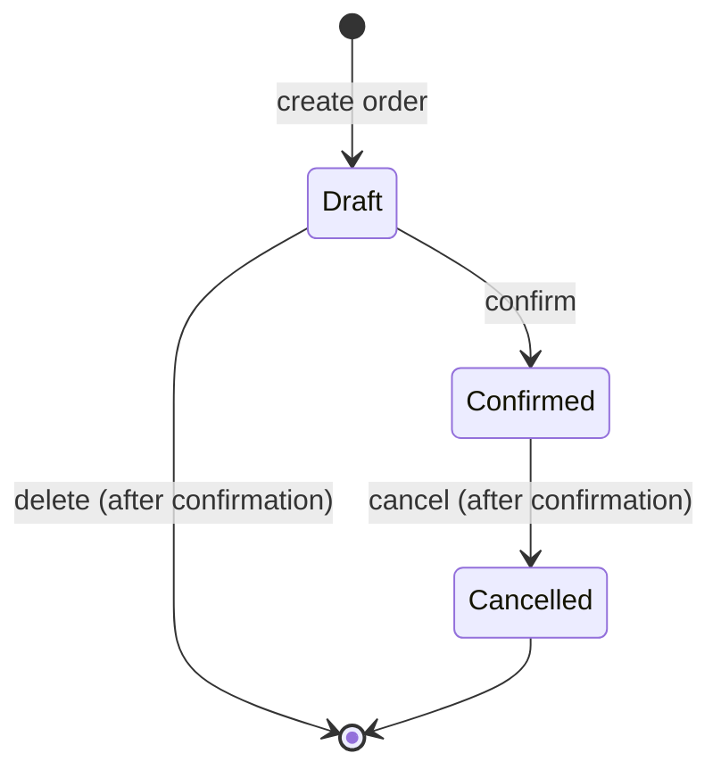

## Document Control

| Field       | Value                                                                  |
|-------------|------------------------------------------------------------------------|
| Version     | 0.1 (draft)                                                            |
| Status      | Draft for review                                                       |
| Sources     | customer-order-brd.md (v0.1), raw-requirement.txt, README.md           |
| Owner       | Prashant                                                               |
| Last update | 2026-10-11                                                             |

## Product Summary

The Customer Order Manager is a browser-only app for recording customers, the orders they place, and the order lines in each order. It uses vanilla JavaScript and runs from a local server started with `npm start`. All data is stored in `localStorage`. Order totals are derived from order lines and shown in one currency, USD by default.

## Goals

* Keep customer records and orders in one browser so they survive reloads (BRD O-01).
* Calculate order totals correctly, using integer cents (BRD O-02).
* Find customers and orders quickly with search and filters (BRD O-03).
* Make design decisions and AI-assisted work reviewable (BRD O-04).

## Non-Goals

These items stay out of this release, as set in the BRD:

* Authentication, user accounts and roles.
* Multi-user or multi-device sync.
* Backend APIs and databases.
* Payments, invoices, tax and discounts.
* Inventory and product catalogue.
* Import and export of data (GAP-07).
* A full audit log. Only `createdAt` and `updatedAt` are stored (GAP-16).
* Reports beyond the total per order and the order list per customer.
* Multiple currencies and languages (GAP-03, GAP-15).

## Users

The primary user is one person who records customers and orders in one browser. There is no login and no role model (GAP-01). The assessor and code reviewer evaluate the build but do not use the product.

## User Journeys

1. Open the app at the local address.
2. Create a customer, or search for an existing one.
3. Open the customer and create a Draft order.
4. Add order lines. The total updates after each change.
5. Confirm the order when it is final. Cancel it if it no longer applies.
6. Return later. The data is still in the same browser.

## Order Status Model

Lines can be added, edited and removed only while an order is in Draft. Confirmed and Cancelled orders are read-only.

## Functional Requirements

Priority values follow the BRD: High is needed for the first release, Medium should be delivered in the same release, and no item is Low.

### Customers

#### FR-01 Create customer

Priority: High. Traces to BR-001.

* A customer needs a name. The name is trimmed and must be 1 to 100 characters.
* Email is optional. When given, it must pass a basic format check and must be unique among customers, ignoring case.
* Phone is optional. When given, it is up to 30 characters of digits, spaces and the symbols `+ - ( ) .`.
* An invalid entry shows an inline error next to the field and is not saved. The entered values stay in the form.
* A saved customer appears in the customer list. The app sets `createdAt` and `updatedAt`.

#### FR-02 Customer list and detail view

Priority: High. Traces to BR-002.

* The list shows name, email and phone for each customer.
* When no customers exist, the list shows an empty state with a button to add a customer.
* The detail view shows all fields of one customer and the list of that customer's orders (see FR-11).
* An unknown or malformed customer ID shows a not-found state.

#### FR-03 Edit customer

Priority: High. Traces to BR-003.

* The same validation as FR-01 applies. A customer's own email does not count as a duplicate.
* Changes persist after a reload. The app updates `updatedAt`.

#### FR-04 Delete customer

Priority: High. Traces to BR-004, GAP-04.

* Deleting asks for confirmation. The dialog states how many orders will be removed. The count can be zero.
* Confirmation removes the customer and all of their orders in one save, so no orphan orders remain.
* If the save fails, nothing is removed (see FR-15).

#### FR-05 Search customers

Priority: High. Traces to BR-005.

* Search matches name or email. It is case-insensitive and matches part of a value.
* A search with no match shows a "no results" message. This is distinct from the empty state in FR-02.

### Orders

#### FR-06 Create order

Priority: High. Traces to BR-006.

* An order must belong to an existing customer. Creating an order without a customer is blocked.
* A new order starts in Draft (GAP-02). An order must have at least one line before it is saved, so the order form requires its first line.
* The app sets `createdAt` and `updatedAt`.

#### FR-07 Add, edit and remove order lines

Priority: High. Traces to BR-007, GAP-05, GAP-14.

* A line has a description, a quantity and a unit price.
* Description is required. It is trimmed and must be 1 to 500 characters.
* Quantity is a whole number from 1 to 9999.
* Unit price is zero or more, with at most two decimal places, and no more than 100,000.00. The app stores it as integer cents.
* The price is captured on the line when it is entered. Later changes to a customer do not affect existing lines.
* Removing a line asks for confirmation.
* The last line of an order cannot be removed, because an order cannot be saved with no lines.
* Lines can be changed only while the order is in Draft (FR-09).
* Invalid input is blocked with an inline error.

#### FR-08 Order total

Priority: High. Traces to BR-008.

* The total is the sum of `quantity * unitPriceCents` over all lines of the order.
* The total is derived each time it is needed. It is never stored.
* The total appears on the order detail view and in the order list. It updates after every line change.
* Money is formatted only at render time, in the configured currency.

#### FR-09 Order status

Priority: Medium. Traces to BR-009, GAP-02.

* Allowed transitions are Draft to Confirmed, and Confirmed to Cancelled.
* A Draft order is removed by deletion (FR-12), not by cancellation.
* Cancelled is a final state.
* Confirmed and Cancelled orders are read-only. Their lines cannot be added, edited or removed.
* Once confirmed, an order cannot return to Draft.

#### FR-10 Filter and search orders

Priority: Medium. Traces to BR-010.

* Orders can be filtered by status: All, Draft, Confirmed or Cancelled.
* Orders can be searched by customer name. The search is case-insensitive and matches part of a value.
* The status filter and the search combine. Every result matches all active criteria.
* The order list shows customer name, status, total and creation date.
* A search or filter with no match shows a "no results" message, distinct from the empty state.

#### FR-11 Orders on the customer detail view

Priority: Medium. Traces to BR-011.

* The customer detail view lists that customer's orders.
* Each order shows its status and total, and links to the order detail view.

#### FR-12 Delete or cancel orders

Priority: Medium. Traces to BR-012, GAP-06.

* A Draft order can be deleted after confirmation.
* A Confirmed order can be cancelled after confirmation. It is kept for history and is not removed.
* A Cancelled order cannot be changed further.

### Data and Quality

#### FR-13 Persistence

Priority: High. Traces to BR-013.

* Each successful change is saved to `localStorage`.
* Data is still present after a reload and after the tab is closed and reopened.
* The app makes no network calls to store data.

#### FR-14 Versioned data and corrupt-data recovery

Priority: High. Traces to BR-014.

* The stored document carries a `schemaVersion`.
* Missing data starts the app with an empty state and no warning.
* Corrupt data, or data with a `schemaVersion` the app does not support, does not crash the app. The app keeps a backup copy of the unreadable data under a separate key.
* After a reset, a dismissible banner (`role="status"`) on the customer list tells the user that a backup was kept.

#### FR-15 Save failures

Priority: High. Traces to BR-015.

* A quota or write error shows a persistent error banner (`role="alert"`) with a retry hint.
* The entered values stay in the form, so the user does not lose input.
* No change is dropped silently.

#### FR-16 Empty and error states

Priority: High. Traces to BR-016.

* Every list and form has a defined empty state, error state and "no results" state where a search or filter applies.
* Validation errors appear inline next to the field they describe.

#### FR-17 Responsive layout and keyboard access

Priority: Medium. Traces to BR-017.

* The app is usable from 360px width up to desktop, as BRD BR-017 requires.
* No page scrolls horizontally at any width from 360px up. Wide tables scroll inside their own wrapper or collapse to stacked cards.
* Every action can be reached and operated with the keyboard. Dialogs trap focus and restore it on close.
* Touch targets are at least 44 by 44px.

#### FR-18 Local run

Priority: High. Traces to BR-018.

* `npm start` serves `src/` at `http://localhost:5173`.
* There is no build step and no runtime dependency in `package.json`.
* `npm test` runs the automated tests.

## Delivery Requirements

These requirements cover how the build is evidenced. They do not change the product.

* DR-01: Decisions and assumptions are recorded with a date, the options considered and the reason for the choice in `docs/decisions/` (BR-019).
* DR-02: Automated tests cover totals, validation and search or filter. Every change to these areas includes tests, and `npm test` passes (BR-020).
* DR-03: Review notes on AI-generated code are kept in `docs/reviews/`. The session record names the LLM used for each phase (BR-021).

## Non-Functional Requirements

* NFR-01 Performance: search and filter update without a page reload. Results appear within 300 ms with 500 customers and 5,000 orders (GAP-11, BRD O-03).
* NFR-02 Accuracy: totals are computed from integer cents. Domain tests show zero mismatches (BRD O-02).
* NFR-03 Security: all user text and stored text render as plain text. The app follows the UI guidelines in `ui.instructions.md`, including the content security policy and the rules for untrusted storage.
* NFR-04 Accessibility: forms, labels, focus and error messages meet WCAG 2.2 AA. Text contrast is at least 4.5:1 in every theme (GAP-10).
* NFR-05 Browser support: current Chrome, Edge, Firefox and Safari on desktop and tablet, and on phones down to 360px (GAP-09, D-25).
* NFR-06 Privacy: names, emails and phone numbers are stored unencrypted in the browser. Only contact details are stored, and the decision is recorded (GAP-08).
* NFR-07 Storage capacity: `localStorage` allows about 5 MB per origin, depending on the browser. The data at the NFR-01 volumes must stay well inside that limit. Measure it during testing (R-01).
* NFR-08 Data loss: browser storage can be cleared, and no export exists in this release. The risk is accepted and recorded (GAP-07, R-01).

## Data Model

| Entity          | Fields                                                              | Rules                                                                 |
|-----------------|---------------------------------------------------------------------|-----------------------------------------------------------------------|
| Customer        | `id`, `name`, `email`, `phone`, `createdAt`, `updatedAt`            | Name required. Email and phone optional. Email unique ignoring case.  |
| Order           | `id`, `customerId`, `status`, `createdAt`, `updatedAt`, `lines[]`   | Status is Draft, Confirmed or Cancelled. Total is derived, not stored. |
| Order line      | `id`, `description`, `quantity`, `unitPriceCents`                   | Quantity 1 to 9999. Unit price is an integer of cents, captured at entry. |
| Stored document | `schemaVersion`, customers, orders                                  | Required for FR-14.                                                    |

Dates are stored as ISO 8601 strings. Currency is set in one configuration constant, USD by default (GAP-03).

## Success Metrics

| ID   | Objective                                    | Metric                                                  | Target                                              |
|------|----------------------------------------------|---------------------------------------------------------|-----------------------------------------------------|
| O-01 | Maintain customer records locally            | Customers and orders survive reload                     | All FR-01 to FR-04 and FR-13 acceptance checks pass |
| O-02 | Record orders and calculate totals correctly | Total matches the sum of line totals in cents           | Zero mismatches in domain tests                     |
| O-03 | Find customers and orders quickly            | Search and filter update without a page reload          | Results within 300 ms at 500 customers and 5,000 orders |
| O-04 | Show engineering ownership                   | Decisions, reviews and AI usage recorded                | A decision record and review note for each major choice |

Timeframes are deferred (GAP-12).

## Assumptions

* A-01: One user per browser, with no login (BRD A-01, GAP-01).
* A-02: Browser only, with no server (BRD A-02).
* A-03: Data is stored in `localStorage` on one device (BRD A-03).
* A-04: Vanilla JavaScript with no framework (BRD A-04).
* A-05: Scope is limited to the BRD. Out-of-scope items stay out (BRD A-05).
* A-06: An order must have at least one line before it is saved. Confirmed.
* A-07: Line descriptions are limited to 500 characters. Confirmed.
* A-08: Status moves one way only. Confirmed orders cannot return to Draft. Confirmed.
* A-09: Lines keep the price captured at entry, so later changes do not alter past orders (GAP-14).

## Open Questions

1. Resolved: an order must have at least one line before it is saved (A-06).
2. Resolved: line descriptions are limited to 500 characters (A-07).
3. Resolved: a Confirmed order cannot return to Draft (A-08).
4. Deferred: timeline, effort estimates and deadline (GAP-12).

## Traceability

| BRD ID | Priority | PRD requirement |
|--------|----------|-----------------|
| BR-001 | High     | FR-01           |
| BR-002 | High     | FR-02           |
| BR-003 | High     | FR-03           |
| BR-004 | High     | FR-04           |
| BR-005 | High     | FR-05           |
| BR-006 | High     | FR-06           |
| BR-007 | High     | FR-07           |
| BR-008 | High     | FR-08           |
| BR-009 | Medium   | FR-09           |
| BR-010 | Medium   | FR-10           |
| BR-011 | Medium   | FR-11           |
| BR-012 | Medium   | FR-12           |
| BR-013 | High     | FR-13           |
| BR-014 | High     | FR-14           |
| BR-015 | High     | FR-15           |
| BR-016 | High     | FR-16           |
| BR-017 | Medium   | FR-17           |
| BR-018 | High     | FR-18           |
| BR-019 | High     | DR-01           |
| BR-020 | High     | DR-02           |
| BR-021 | High     | DR-03           |

## Quality Gates

| Check                                           | Status                                  |
|-------------------------------------------------|-----------------------------------------|
| Every BRD business requirement traced           | Complete (see Traceability)             |
| Every requirement has acceptance criteria       | Complete                                |
| Decisions beyond the BRD are flagged            | Complete (A-06 to A-09)                 |
| Success metrics have targets                    | Complete. Timeframes deferred (GAP-12)  |
